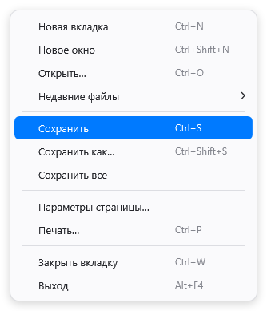
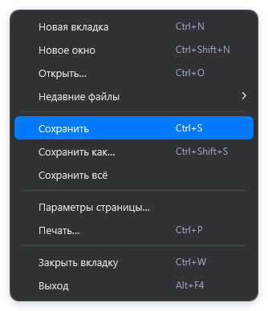
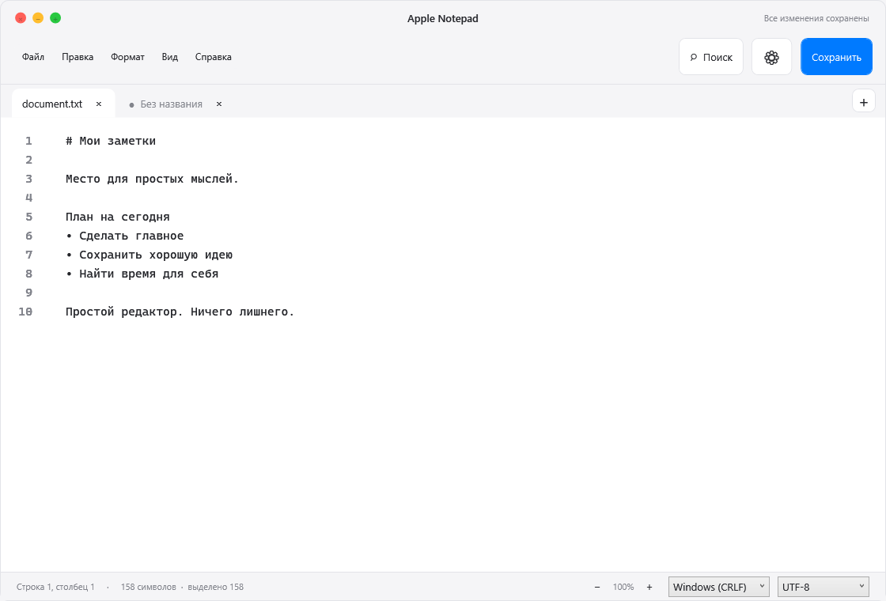

# Apple Notepad

Текстовый редактор для Windows с оформлением в стиле macOS: светлая и тёмная темы, округлённые кнопки, вкладки и спокойная панель инструментов.

Выпадающие меню и меню по правой кнопке оформлены в том же стиле: округлённые панели, мягкая тень, аккуратные разделители, галочки и подсказки горячих клавиш. Они переключаются вместе со светлой и тёмной темой. Контекстные меню редактора, поиска и полей диалогов поддерживают обычные команды редактирования; в редакторе сохранены подсказки орфографии.

 

[Меню по правой кнопке: светлая тема](docs/context-light.png) · [Тёмная тема](docs/context-dark.png)



[Тёмная тема](docs/preview-dark.png)

Остальные элементы оформлены в том же стиле: тонкие полосы прокрутки, округлённые списки кодировки и концов строк, флажки, поля ввода и подсказки. Выбор шрифта поддерживает поиск, начертание, размер и живой предпросмотр; изменения применяются только после подтверждения. Открытие и сохранение файлов, настройки, печать, параметры страницы и подтверждения используют общие окна в светлой и тёмной темах.

[Редактор и строка состояния](docs/controls-light.png) · [Тёмная тема](docs/controls-dark.png) · [Выбор шрифта](docs/font-light.png) · [Шрифт в тёмной теме](docs/font-dark.png) · [Открытие файлов](docs/open-file.png) · [Настройки](docs/settings.png)

При открытии можно выбрать несколько файлов с Ctrl/Shift, перейти по пути через Ctrl+L, показать скрытые файлы и создать папку. При сохранении запрашивается подтверждение перезаписи. Окна, которые показывает сам драйвер принтера (например, выбор имени PDF), оформляются средствами Windows.

## Скачать и запустить

### Обычная установка

1. [Скачайте AppleNotepad-Setup-1.1.1.exe](https://github.com/MaksimDenisov31/apple-notepad/releases/download/v1.1.1/AppleNotepad-Setup-1.1.1.exe).
2. Запустите установщик, выберите папку и при желании отметьте ярлык на рабочем столе.
3. Нажмите **Установить**. Программа появится в меню **Пуск**, удалить её можно через **Параметры Windows → Приложения**.

Для передачи на другой компьютер достаточно **одного файла установщика**. Все файлы приложения внутри него. Установка выполняется для текущего пользователя, обычно без прав администратора; папка по умолчанию — `%LOCALAPPDATA%\Programs\Apple Notepad`. Установщик доступен на русском и английском языках. Обновление выполняется повторным запуском нового установщика; пользовательские документы, настройки и восстановленные вкладки не удаляются. Цифровая подпись издателя не используется.

### Сделать блокнотом по умолчанию

На последней странице установщика по умолчанию отмечен пункт **«Выбрать Apple Notepad для текстовых файлов»**. Нажмите **«Готово»**: откроется системный выбор приложений, где нужно подтвердить Apple Notepad для `.txt` и при желании `.log`. На актуальной Windows 11 открывается страница именно Apple Notepad. Windows 10 и ранние сборки Windows 11 могут открыть общий список приложений по умолчанию — там выберите Apple Notepad.

Windows 10/11 требует подтверждения в системном интерфейсе и не позволяет установщику незаметно назначить приложение по умолчанию. Установщик готовит регистрацию и открывает нужную страницу, а выбор остаётся за пользователем. Если менять приложение не нужно, снимите этот пункт. При тихой установке настройки не открываются; существующий выбор сохраняется. Подробности: [платформа приложений по умолчанию Microsoft](https://learn.microsoft.com/en-us/windows/apps/develop/windows-integration/default-apps-platform).

Удаление программы убирает её регистрацию и пункты «Открыть с помощью», сохраняя пользовательские документы. Переносная версия из ZIP сама не регистрируется в системе.

### Без установки

[Скачайте ZIP проекта](https://github.com/MaksimDenisov31/apple-notepad/archive/refs/heads/main.zip), распакуйте его и откройте **AppleNotepad.exe** или **Start.bat**. Готовый EXE включён в репозиторий.

Для открытия файла можно перетащить его в окно, воспользоваться меню **Файл → Открыть** или передать путь в командной строке.

Требуются **Windows 10/11 и .NET Framework 4.8**. Установка .NET SDK, Node.js, Python и интернет для работы не нужны. Установщик регистрирует Apple Notepad для открытия `.txt` и `.log`; системный Блокнот остаётся установленным.
Установщик проверяет .NET Framework: если на старой Windows 10 его нет, предложит официальную страницу Microsoft. Сам пакет .NET в установщик не включён; для его первоначального скачивания потребуется интернет.

## Возможности

| Раздел | Что работает |
|---|---|
| Файлы | Создание, открытие нескольких файлов, сохранение, «Сохранить как», «Сохранить всё», недавние файлы, вкладки и отдельные окна |
| Редактирование | Многошаговые отмена/повтор, вырезать/копировать/вставить, удалить, выделить всё, время/дата, режим журнала `.LOG` |
| Поиск | Далее/назад, по кругу или без повтора, учёт регистра, слово целиком, замена и замена всех, переход к строке |
| Текст | Шрифт, размер, полужирное/курсивное начертание шрифта, перенос строк, масштаб, номера строк, позиция курсора, число символов |
| Кодировки | UTF-8, UTF-8 с BOM, UTF-16 LE/BE, UTF-32 LE/BE и системная ANSI-кодировка; автоопределение BOM и проверка UTF-8 |
| Концы строк | Windows CRLF, Unix LF, старый Mac CR; выбор в строке состояния |
| Печать | Собственный диалог выбора принтера, принтер или PDF, диапазон страниц, поля, ориентация, колонтитулы с именем файла/датой/временем/номером страницы |
| Удобство | Светлая/тёмная темы, полный экран, сохранение предпочтений, восстановление вкладок и несохранённого текста |
| Дополнительно | Проверка орфографии средствами Windows; вставка Markdown-разметки и отдельный предпросмотр заголовков, списков, ссылок, кода, жирного и курсивного текста |

Это самостоятельный редактор обычного текста с функциями классического Блокнота и дополнительными возможностями. Markdown хранится как текст, без скрытого форматирования. Предпросмотр поддерживает базовую разметку и не является полным движком CommonMark. Проверка орфографии зависит от словарей и языка Windows; автоматическая коррекция и облачные ИИ-функции Microsoft Notepad не реализованы. Русский интерфейс, текст файлов может быть на любом языке.

## Сохранение и восстановление

- **Ctrl+S** записывает файл. Сначала создаётся временный файл в той же папке, затем атомарно заменяется оригинал. При ошибке записи оригинал остаётся на месте.
- Если файл изменён другой программой, редактор предложит перезагрузить его. При попытке сохранить поверх внешнего изменения запрашивается подтверждение.
- По умолчанию закрытие окна сохраняет вкладки и незаконченный текст локально, чтобы восстановить их при следующем запуске. Исходные документы это не перезаписывает.
- Закрытие отдельной изменённой вкладки спрашивает, нужно ли сохранить файл.
- В **Настройках** можно отключить восстановление. Тогда при выходе появится обычный запрос сохранения изменённых документов.
- Несколько открытых окон используют отдельные снимки; при восстановлении активное окно не дублируется. Закрытые окна восстанавливаются вкладками в одном окне.
- Настройки и снимки находятся в `%LOCALAPPDATA%\AppleNotepad`. Это локальные данные, они не отправляются в интернет и не входят в репозиторий. Не удаляйте эту папку, пока вам нужен восстановленный несохранённый текст.
- Проверка кодировки не угадывает все старые кодовые страницы: для файла без BOM и с невалидным UTF-8 используется текущая ANSI-кодировка Windows. Перед сменой кодировки проверьте текст. Символы, не представимые в выбранной кодировке, вызывают ошибку сохранения вместо молчаливой замены на `?`.

## Горячие клавиши

| Действие | Клавиши |
|---|---|
| Новая вкладка / новое окно | Ctrl+N / Ctrl+Shift+N |
| Открыть / сохранить / сохранить как | Ctrl+O / Ctrl+S / Ctrl+Shift+S |
| Закрыть вкладку / переключить вкладку | Ctrl+W / Ctrl+Tab и Ctrl+Shift+Tab |
| Найти / заменить | Ctrl+F / Ctrl+H |
| Найти далее / ранее | F3 / Shift+F3 |
| Перейти к строке | Ctrl+G |
| Дата и время | F5 |
| Печать | Ctrl+P |
| Масштаб | Ctrl+колесо, Ctrl+плюс/минус; Ctrl+0 — 100% |
| Полный экран | F11 |
| Markdown: жирный / курсив | Ctrl+B / Ctrl+I |

## Сборка и проверки

**Build.bat** собирает WPF-приложение на C# штатным компилятором .NET Framework. Сторонних библиотек и NuGet-пакетов нет.

**BuildInstaller.bat** упаковывает готовый EXE с помощью установленного Inno Setup 6/7 в `installer-output\AppleNotepad-Setup-1.1.1.exe`. После изменения исходников сначала выполните `Build.bat`, затем `BuildInstaller.bat`. Сценарий установки находится в `installer/AppleNotepad.iss`. Inno Setup нужен только разработчику; на компьютере пользователя он не требуется. Установщики публикуются в [Releases](https://github.com/MaksimDenisov31/apple-notepad/releases).

`tools/VerifyInstaller.ps1` проверяет установку, повторную установку, ярлыки, запуск и удаление на изолированном тестовом AppId, сохраняя пользовательские файлы. Тестовая установка не меняет существующую установку Apple Notepad.

```bat
Build.bat
AppleNotepad.exe --self-test
AppleNotepad.exe --ui-test
```

Проверки используют только собственные фикстуры в `test-results`, а не пользовательские документы. Проверяются 21 сочетание кодировки и окончаний строк, безопасная запись, поиск и замена, настройки, изоляция и восстановление сеансов, пагинация печати, вкладки, отмена/повтор, сохранение из окна, темы и предпросмотр. Печать на физическом принтере и системные диалоги требуют ручной проверки на конкретном ПК.

Исходники — `src`, интерфейс — `MainWindow.xaml`, иконка — `assets/app.ico`. Скрипт `tools/MakeIcon.ps1` создаёт иконку из векторных фигур. Приложение — независимый проект, не связано с Apple или Microsoft.
